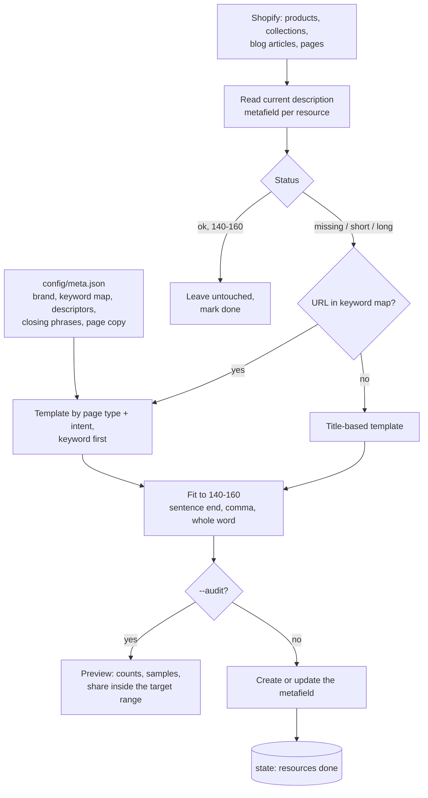

# Meta Description Generator: every page in a Shopify store audited, and the missing or badly sized descriptions rewritten

A script that walks every product, collection, blog article and page in a store, checks the meta description on each, and writes a new one where it is missing, too short or too long. Descriptions are built from templates chosen by page type and search intent, and pages with a known target keyword get that keyword up front.

## The problem

A store with a few hundred products and a long-running blog has hundreds of pages, and most never get a hand-written meta description. Search engines then show whatever text they find on the page, or a description written years ago that is cut off mid-word in the results.

Writing them by hand does not happen. Generating them all from one template makes every result look the same. The middle path is a small set of templates that vary by what the page is and what the searcher wants, anchored to the keyword each page actually ranks for.

## What it does

`src/generate-meta-descriptions.js` processes four resource types. For each resource it reads the current description and classifies it:

| Status | Rule | Action |
|---|---|---|
| Missing | Empty or absent | Generate |
| Too short | Under 140 characters | Rewrite |
| Too long | Over 160 characters | Rewrite |
| OK | 140 to 160 characters | Leave untouched |

New descriptions come from a template per page type:

- **Products:** "Buy" for transactional keywords, "Shop" for commercial ones, with a descriptor built from the product type and quality words found in the title. Wholesale products get their own closing line.
- **Collections:** "Shop" or "Browse" by intent, with an optional wholesale note.
- **Articles:** a "learn about" form for informational keywords and a "find the best" form for commercial ones.
- **Pages:** a configured description for FAQ, about and contact pages, and a generic one for the rest.

`--audit` prints everything it would change, with counts by status and type, sample before-and-after pairs, and how many generated descriptions landed inside the target range.

## Architecture



## Key design decisions

**Good descriptions are never overwritten.** Anything already between 140 and 160 characters is left exactly as it is. The tool fills gaps and fixes lengths; it does not replace copy a person wrote to fit.

**Intent picks the template.** A page ranking for a buying keyword opens with "Buy". A research keyword opens with "Shop" or "Browse". An informational article opens with "Learn about". The keyword map carries the intent for each URL, taken from search data.

**The keyword goes first.** For mapped pages the target keyword is the first thing in the description, where it is shown in bold in results and least likely to be cut off.

**Length is fitted, not hoped for.** A description that runs long is cut at the last sentence end inside the range, then at the last comma, then at the last whole word. It is never cut mid-word. One that comes out short is kept and shows up in the audit as outside the target, so the closing phrases can be adjusted.

**Descriptors come from the product itself.** The product type and title are matched against a descriptor table, longest match first, and quality words in the title are carried into the description. Two products of different kinds do not get the same sentence.

**Audit first.** `--audit` makes no writes and reports what share of the generated descriptions hit the range. That number is the check on the templates before anything is applied.

**Resumable.** Each finished resource is recorded in a state file, so an interrupted run over a large catalog continues where it stopped.

**Draft and archived products are skipped.** Only active products get descriptions.

**All wording is config.** The brand, the keyword map, descriptors and every closing phrase live in `config/meta.json`. The tests run the templates against the example config and check lengths.

## Repository layout

```
src/generate-meta-descriptions.js   audit, templates, length fitting, metafield writes
config/meta.example.json            example brand, keyword map, descriptors and phrases
scripts/test-meta.js                offline tests for length rules and templates
```

## Setup

Requires Node 20+ and a Shopify Admin API token with read and write access to products, collections, content and metafields.

```bash
npm install
npm test                                      # offline, no store needed
cp .env.example .env                          # store and token
cp config/meta.example.json config/meta.json  # your brand, keywords and wording
npm run audit                                 # preview every change, write nothing
node src/generate-meta-descriptions.js --products   # apply to one resource type
npm run apply                                 # apply to everything
```

| Variable | Purpose |
|---|---|
| `SHOPIFY_STORE`, `SHOPIFY_ADMIN_TOKEN` | Reading resources and writing metafields |
| `COMPANY_NAME` | Optional override of `brand` in the config |
| `CONFIG_DIR`, `STATE_DIR` | Override the `config/` and `state/` locations |

Descriptions are written to the `global.description_tag` metafield, which Shopify themes use for the page's meta description.

---

Extracted from a production automation suite I built and ran for a live e-commerce and B2B wholesale business, 2026.

© Michael Wootan. Source shared for portfolio review; all rights reserved.
